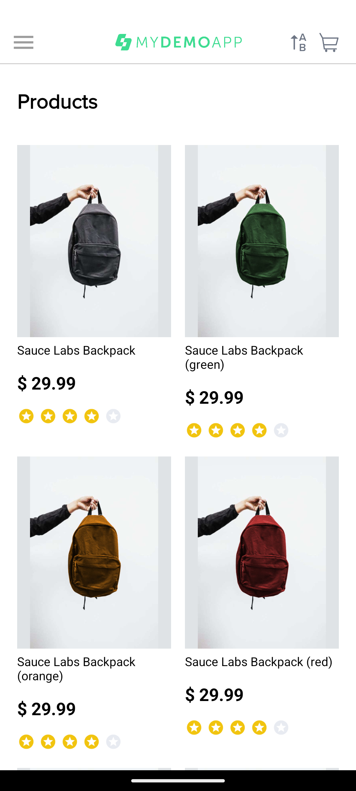
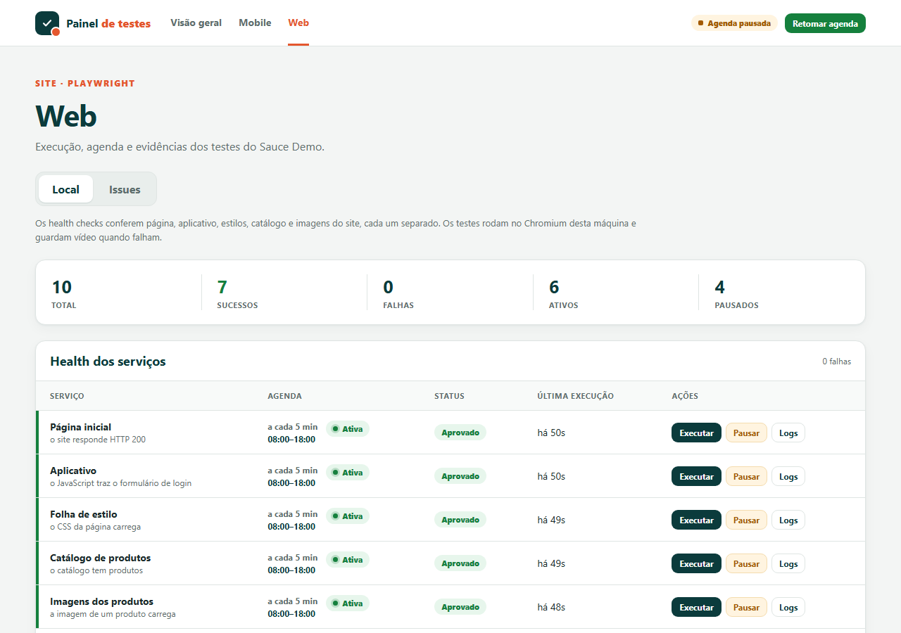

# QA Automation Portfolio

[](https://github.com/alvessq/qa-automation-portfolio/actions/workflows/ci.yml)
[](https://github.com/alvessq/qa-automation-portfolio/actions/workflows/mobile-e2e.yml)
[](https://github.com/alvessq/qa-automation-portfolio/actions/workflows/web-monitoring.yml)

Projeto público que recria, com apps de demonstração, a abordagem de automação que uso no trabalho. Os cases completos estão no meu [portfólio](https://alvessq.github.io).

Monorepo de automação de testes com três frentes:

| Workspace | Stack | O que faz |
|---|---|---|
| [`apps/mobile-e2e`](apps/mobile-e2e) | Appium 3 + WebdriverIO 9 + TypeScript | E2E do app Android **[Sauce Labs My Demo App](https://github.com/saucelabs/my-demo-app-android)** |
| [`apps/web-e2e`](apps/web-e2e) | Playwright + TypeScript | E2E web do **[Sauce Demo](https://www.saucedemo.com)** e health check |
| [`apps/test-scheduler`](apps/test-scheduler) | Node.js + Express + React | Agenda e executa os testes com fila única, triagem de falhas e nuvem, num painel web |

Os dois alvos são aplicações públicas mantidas pela Sauce Labs justamente para prática de automação.

<!-- GIF: docs/images/mobile-e2e-demo.gif (teste rodando no emulador) -->
<!--  -->

<p align="center">
  
  &nbsp;
  
</p>

---

## Destaques

- **Page Object Model** nos dois projetos E2E, com uma classe base que concentra esperas, preenchimento e a estratégia de seletores.
- **Testes independentes:** cada cenário mobile começa com o app limpo (`mobile: clearApp`), e cada cenário web usa um contexto novo do navegador com a sessão reaproveitada via `storageState`.
- **Massa de dados por factory:** os dados são válidos por padrão, e cada teste sobrescreve só o que importa para o cenário. Credenciais podem vir de `.env` ou de secrets.
- **Evidências automáticas em falhas:** screenshot, XML da tela e vídeo (mobile), além de trace, vídeo e screenshot (web).
- **Relatórios:** spec/list no console, JUnit XML, relatório HTML do Playwright, `summary.json` e resumo em Markdown na página da execução do GitHub Actions.
- **Diagnóstico de ambiente** (`doctor`) antes da suíte mobile. Ele confere JDK, SDK, `adb`, device, APK e driver, e falha cedo com uma mensagem clara.
- **CI no GitHub Actions** com emulador Android acelerado por KVM, cache de AVD e de driver, monitoramento agendado e artifacts com as evidências.
- **Agendador** com janela de horário por job (inclusive janelas que atravessam a meia-noite), fila serial e uma lista fechada de scripts permitidos. A API nunca executa comandos livres.
- **Triagem de falhas:** um job que falha é repetido antes de qualquer aviso. Falhou em todas as repetições: bug, com issue no GitHub (sem duplicar). Passou em alguma: falha passageira. O ambiente caiu: problema de ambiente, sem issue.
- **2 bugs reais encontrados** no app de demonstração ([veja abaixo](#bugs-encontrados)).

## Estrutura

```
.
├── .github/
│   ├── workflows/
│   │   ├── ci.yml                 # typecheck + unitários + web E2E em push/PR
│   │   ├── mobile-e2e.yml         # Android no emulador (manual, push e semanal)
│   │   └── web-monitoring.yml     # health + smoke agendados
│   └── scripts/run-mobile-suite.sh
├── apps/
│   ├── mobile-e2e/
│   │   ├── wdio.conf.ts           # capabilities, hooks de evidência, reporters
│   │   ├── suites.json            # smoke / regression -> lista de specs
│   │   ├── scripts/               # doctor, download do APK, driver Appium, runner de suíte
│   │   └── test/
│   │       ├── config/            # leitura de .env e constantes
│   │       ├── data/              # usuários, produtos, factories de checkout
│   │       ├── helpers/           # reset do app, fluxos reutilizáveis, diálogos do sistema
│   │       ├── pages/             # Page Objects (+ checkout/)
│   │       ├── reporting/         # evidências e resumo da execução
│   │       └── specs/             # um arquivo por funcionalidade
│   ├── web-e2e/
│   │   ├── playwright.config.ts   # projetos setup/autenticado/convidado
│   │   ├── scripts/health.mjs
│   │   ├── src/{config,data,fixtures,helpers,pages}/
│   │   └── tests/
│   └── test-scheduler/
│       ├── config.json            # testes locais versionados
│       ├── cloud-schedule.json    # agenda da nuvem versionada
│       ├── src/                   # servidor, fila, triagem, nuvem, vídeos
│       ├── web/                   # painel em React + Vite + TypeScript
│       └── test/                  # testes unitários (node:test)
└── docs/
    └── casos-de-teste.md
```

## Pré-requisitos

| Para | Precisa de |
|---|---|
| Tudo | Node.js 20.11+ (a CI usa 22, veja `.nvmrc`) |
| Mobile | JDK 17, Android SDK com `ANDROID_HOME` definido, `platform-tools` no `PATH` e um emulador ou celular com depuração USB |
| Web | Nada além do Node. O Chromium é instalado pelo Playwright |

## Como rodar

```bash
npm install
```

### Mobile (Appium)

```bash
npm run mobile:setup          # instala o driver UiAutomator2 e baixa o APK público
# inicie um emulador (Android Studio > Device Manager) ou conecte um celular
npm run mobile:doctor         # confere o ambiente
npm run test:mobile:smoke     # catálogo + login
npm run test:mobile:regression
npm run test:mobile           # todas as specs
```

**Falhou só na CI?** `npm run ci:local -w mobile-e2e` sobe um emulador sem janela e sem GPU (renderização por software), na porta 5556, e roda a suíte com os timeouts e a nova tentativa da CI. Use `-- regression` para outra suíte e `-- smoke --gpu` para comparar com a GPU ligada. Investigar aqui não gasta minutos do GitHub Actions.

**Emulador travado ou lento?** Antes de cada suíte local, o emulador é conferido: se não estiver saudável (offline ou com o Android sem terminar de ligar), é reiniciado na hora; e, mesmo saudável, é reiniciado a cada 3 execuções, sem apagar os dados (`EMULATOR_RECYCLE_EVERY`; `EMULATOR_RECYCLE=false` desliga).

**Na nuvem**, antes dos testes, o emulador sem placa de vídeo é preparado: espera o Android ligar, é reiniciado uma vez se não ficar saudável, roda com resolução menor (720x1600) e animações desligadas, e os diálogos do sistema, como o "não está respondendo", são fechados. O snapshot do emulador fica em cache assim que é criado, mesmo que os testes falhem depois.

**Emulador caiu no meio da suíte?** Um vigia pergunta ao `adb` a cada 15 s se o device responde. Depois de duas falhas seguidas, a suíte é encerrada na hora com a mensagem `device offline` (código de saída 3), em vez de cada teste esperar o próprio timeout. A triagem do agendador reconhece essa mensagem como problema de ambiente.

O WebdriverIO sobe o servidor Appium sozinho, na porta 4723. Cada spec também tem o próprio script, com a mesma conferência do ambiente e o mesmo vigia das suítes:

```bash
npm run spec:checkout -w mobile-e2e
npm run health -w mobile-e2e      # celular online, APK e driver do Appium
```

Evidências ficam em `apps/mobile-e2e/test-results/`: `junit/`, `screenshots/`, `videos/`, `page-source/`, `logs/` e `summary.json`. A tela é gravada em todo teste, mas o vídeo só é guardado quando o teste falha (os 3 mais recentes de cada teste).

### Web (Playwright)

```bash
npm run browsers:install -w web-e2e   # primeira vez
npm run test:web                       # suíte completa
npm run test:web:smoke                 # apenas @smoke
npm run health:web                     # 5 conferências do site, cada uma com seu resultado
npm run health:web -- imagens catalogo  # só as conferências escolhidas
npm run spec:cart -w web-e2e           # uma spec (também health:pagina, health:imagens...)
npm run report:web                     # abre o relatório HTML
```

### Agendador e painel

```bash
npm run scheduler                      # gera o painel e abre em http://127.0.0.1:7400
npm run dev:web -w test-scheduler      # painel com recarga automática (com o agendador rodando)
```

O painel é feito em **React + Vite + TypeScript** e o servidor em Express. A estrutura é a mesma para os dois produtos:

- **Visão geral:** total de testes, o que está executando, falhas, situação do GitHub e um cartão por produto (Mobile e Web), além da configuração que falta.
- **Mobile e Web**, cada um com abas que o painel lembra entre visitas:
  - **Local:** testes rodando nesta máquina.
    - **Health dos serviços:** uma linha por conferência (no web: página, aplicativo, estilos, catálogo e imagens; no mobile: celular online, APK e driver do Appium), cada uma com intervalo, janela de horário, próxima execução e logs.
    - **Testes (Local):** fila única com ↑ ↓ ×, "Novo" com automações prontas (suítes, testes e health checks lidos dos `package.json`), edição na própria linha, escolha das specs do smoke e da regressão, edição da agenda em lote, "O que testa" e confirmação antes de excluir.
    - **Histórico:** filtros por teste, status, data e busca, com paginação. Cada execução abre com o log e o vídeo; quando não há vídeo, o painel explica o motivo.
  - **GitHub** (mobile): os mesmos testes no emulador do GitHub Actions.
    - **Testes (GitHub):** executar, cancelar e ver logs, screenshots e vídeo de cada execução.
    - **Agenda:** horários fáceis de escolher (a cada X horas, todo dia, seg–sex ou cron), na ordem da lista. A fila dispara um de cada vez e só manda o próximo quando a execução anterior terminar.
    - **Histórico:** as execuções da nuvem, com filtros.
  - **Issues:** o que a triagem decidiu sobre cada falha, com a issue aberta, o vídeo e o que está sendo reproduzido agora.

Detalhes que vêm do uso no dia a dia:

- **Uma execução por vez:** health e E2E dividem a mesma fila, porque o emulador e o site não devem receber duas suítes ao mesmo tempo.
- **Vídeo só de falha:** a tela é gravada sempre, mas o arquivo só fica quando o teste falha, e ficam só os 3 mais recentes de cada teste.
- **Configuração conferida na subida:** a visão geral e o log listam as variáveis que faltam e o que cada ausência desliga, sem nunca mostrar os valores.
- **Celular preparado sozinho:** se houver teste mobile ativo, ao abrir o painel ele confere se saiu um APK novo e, se nenhum device estiver online, liga um emulador em segundo plano (`PREPARE_MOBILE`). O aviso "Emulador desligado" tem o botão "Preparar celular agora"; pelo terminal, `npm run prepare:device -w mobile-e2e`.
- **Abre pausado:** abrir o painel não dispara nada, nem localmente nem na nuvem. Retomar a agenda é uma decisão explícita, no botão do topo (`START_PAUSED=false` muda o padrão; na CI a agenda nunca começa pausada).
- A lista de testes locais fica em [`config.json`](apps/test-scheduler/config.json) e a agenda da nuvem em [`cloud-schedule.json`](apps/test-scheduler/cloud-schedule.json), os dois versionados. Só scripts que existem nos `package.json` podem ser agendados, nunca um comando livre.

#### Triagem de falhas

Teste E2E às vezes falha por instabilidade e não por defeito. Para não transformar cada falha em alarme, os jobs com `"triage": true` passam por uma triagem antes de qualquer aviso:

```
job falha ──► repete até 3 vezes (na frente da fila)
               ├─ falhou em todas ......... bug confirmado ─► issue no GitHub + webhook
               ├─ passou em alguma ........ falha passageira ─► só webhook
               └─ saída de ambiente caído . problema de ambiente ─► só webhook
```

- **Problema de ambiente** é reconhecido pela saída: device offline, sessão do Appium recusada, DNS ou rede fora, navegador não instalado ([`triage.mjs`](apps/test-scheduler/src/triage.mjs)). Nesses casos o job nem é repetido.
- **Sem issue duplicada:** cada falha ganha uma impressão digital (job + primeira linha de erro, sem números). Se já existe issue aberta com a mesma impressão, a triagem comenta nela em vez de abrir outra.
- **Avisos opcionais:** com `GITHUB_REPOSITORY` e `GITHUB_TOKEN`, bug confirmado vira issue com o rótulo `triagem`. Com `TRIAGE_WEBHOOK_URL`, todo veredito gera um aviso curto (Slack, Teams ou Discord). Sem nada configurado, os vereditos aparecem só no painel.
- O health check fica de fora (`"triage": false`): ele existe justamente para avisar rápido.
- A aba **Issues** do painel mostra cada veredito, a issue aberta e o vídeo da falha.

## Configuração

Cada workspace tem um `.env.example`. Copie para `.env` só se quiser sobrescrever os padrões. O `.env` nunca é versionado.

| Variável | Workspace | Padrão |
|---|---|---|
| `ANDROID_UDID` | mobile | primeiro device online |
| `ANDROID_PLATFORM_VERSION` | mobile | versão do device |
| `APP_PATH` | mobile | `./apps/my-demo-app.apk` |
| `MDA_RELEASE_TAG` | mobile | último release |
| `RECORD_VIDEO` / `VIDEOS_TO_KEEP` | mobile | `true` / `3` por teste |
| `BASE_URL` | web | `https://www.saucedemo.com` |
| `SAUCE_STANDARD_USER` / `SAUCE_PASSWORD` | web | credenciais públicas do site |
| `HOST` / `PORT` | scheduler | `127.0.0.1` / `7400` |
| `SCHEDULER_TZ` | scheduler | `America/Sao_Paulo` |
| `START_PAUSED` | scheduler | `true` (a agenda abre pausada) |
| `PANEL_USER` / `PANEL_PASSWORD` | scheduler | vazio (obrigatório fora de localhost) |
| `TRIAGE_RETRIES` | scheduler | `3` |
| `GITHUB_REPOSITORY` / `GITHUB_TOKEN` | scheduler | vazio (sem issues e sem nuvem pelo painel; sem token a nuvem fica só leitura) |
| `TRIAGE_WEBHOOK_URL` | scheduler | vazio (sem webhook) |

## Cenários cobertos

**Mobile: 18 testes em 6 specs**

| Spec | Cenários |
|---|---|
| `catalog` | catálogo carregado com carrinho vazio, ordenação por nome (A–Z e Z–A) e por preço (crescente e decrescente) |
| `login` | login válido, usuário bloqueado, usuário obrigatório, senha obrigatória |
| `product-details` | nome e preço, ajuste de quantidade, badge do carrinho |
| `cart` | soma de vários produtos, recálculo ao mudar a quantidade, remoção até o carrinho ficar vazio |
| `checkout` | compra de ponta a ponta (endereço, pagamento, revisão, confirmação), validação dos campos obrigatórios |
| `logout` | encerramento da sessão com confirmação nativa do Android |

**Web: 19 testes + setup de autenticação**

| Spec | Cenários |
|---|---|
| `login` | login válido `@smoke`, bloqueado, senha errada, campos obrigatórios, acesso direto sem sessão |
| `inventory` | listagem `@smoke`, três ordenações, detalhe do produto, logout |
| `cart` | adicionar e ver o badge `@smoke`, remover, continuar comprando |
| `checkout` | compra completa com conferência de subtotal, imposto e total `@smoke`, três validações de campo |

O detalhamento de cada cenário está em [`docs/casos-de-teste.md`](docs/casos-de-teste.md).

## CI/CD

| Workflow | Quando roda | O que faz |
|---|---|---|
| **CI** | push na `main`, pull requests, manual | typecheck, testes unitários do agendador, health check e suíte web completa |
| **Mobile E2E** | manual (escolhe `smoke`, `regression` ou uma spec), push em `apps/mobile-e2e/**`, toda segunda-feira | sobe o emulador Android API 34 com KVM, baixa o APK, roda a suíte e publica evidências e logcat |
| **Web Monitoring** | 3 vezes por dia em dias úteis, manual | health check e smoke, como monitoramento sintético |

Cada execução publica artifacts com relatórios e evidências por 14 dias. A suíte mobile também escreve uma tabela de resultados no resumo da execução.

## Bugs encontrados

Durante a automação apareceram dois defeitos no **My Demo App Android 2.3.0**:

1. **O app fecha ao abrir produtos abaixo da 6ª posição do catálogo.**
   `java.lang.ArrayIndexOutOfBoundsException: length=6; index=12` em `ProductCatalogFragment.java:156`. O catálogo lista as variações de cor de cada produto, mas o clique indexa uma lista que só tem os 6 produtos base.
   *Contorno nos testes:* cada produto da massa declara a ordenação que o coloca no topo (`listedFirstBy`), e os cenários só abrem produtos que estão nessa posição.

2. **O badge do carrinho no catálogo não se atualiza ao voltar da tela de produto.**
   Depois de adicionar itens e voltar, o catálogo mostra o carrinho vazio, embora os itens estejam no carrinho. O badge só fica correto depois de navegar para outra tela.
   *Contorno nos testes:* a contagem é conferida na tela do carrinho, onde o badge é renderizado corretamente.

## Decisões técnicas

- **Seletores mobile:** a ordem de preferência é `resource-id`, depois accessibility id (`content-desc`) e, por último, texto. Os dois primeiros não dependem do idioma nem da cópia do app.
- **Isolamento sem reinstalar:** o `mobile: clearApp` zera os dados do app em cerca de 1 segundo. Reinstalar o APK a cada teste levaria vários.
- **Uma suíte por vez no agendador:** o emulador não suporta sessões concorrentes, e rodar em série evita falsos negativos por disputa de recursos.
- **Agendador seguro por padrão:** ele escuta só em `127.0.0.1` e abre com a agenda pausada. Para escutar na rede é obrigatório definir `PANEL_USER` e `PANEL_PASSWORD` (HTTP Basic, comparação em tempo constante); sem isso ele se recusa a subir. Jobs só referenciam scripts que existem no `package.json` dos workspaces permitidos, e qualquer outro valor é recusado com HTTP 400.
- **Retry só na CI:** localmente, uma falha aparece na primeira vez. Na CI, uma nova tentativa absorve a instabilidade do emulador sem GPU.

## Licença

[MIT](LICENSE)
